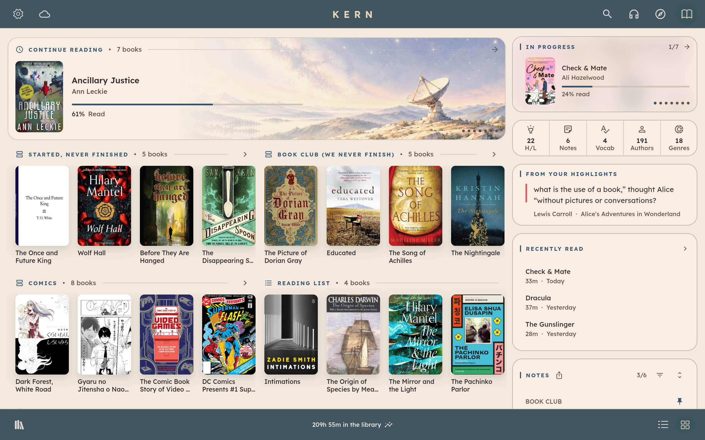
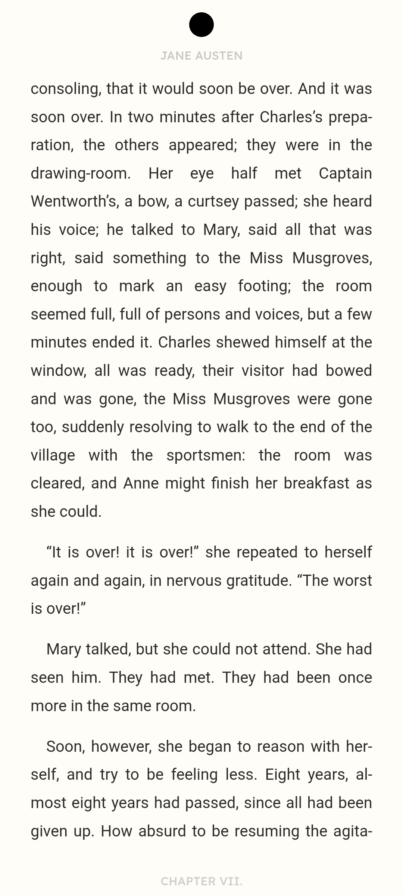
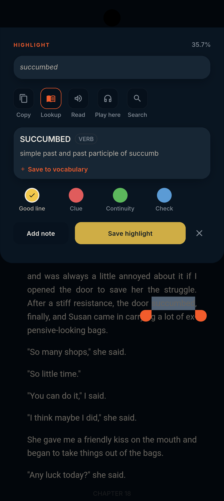
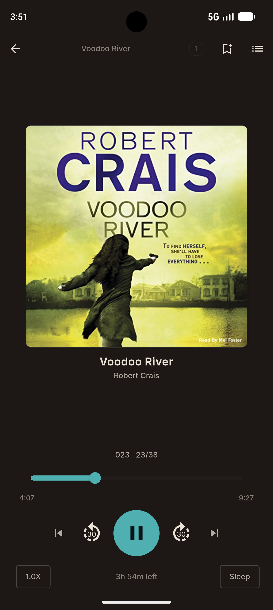
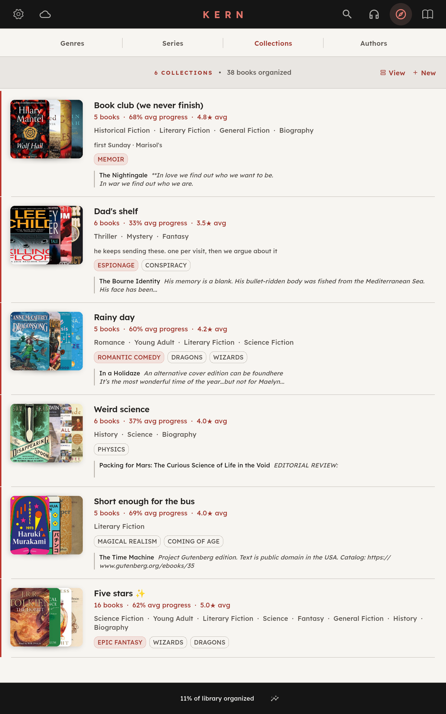
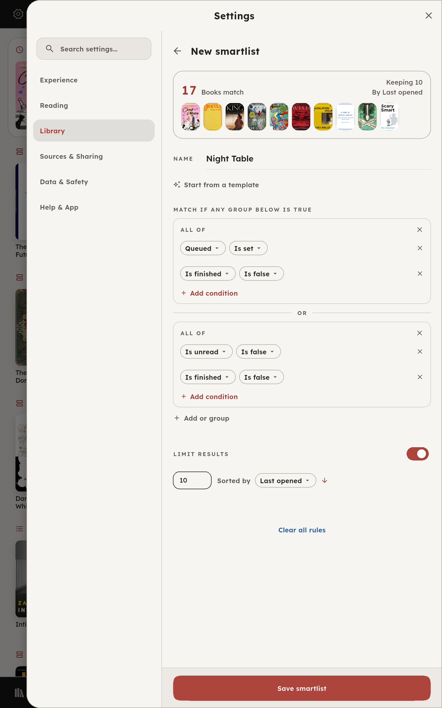
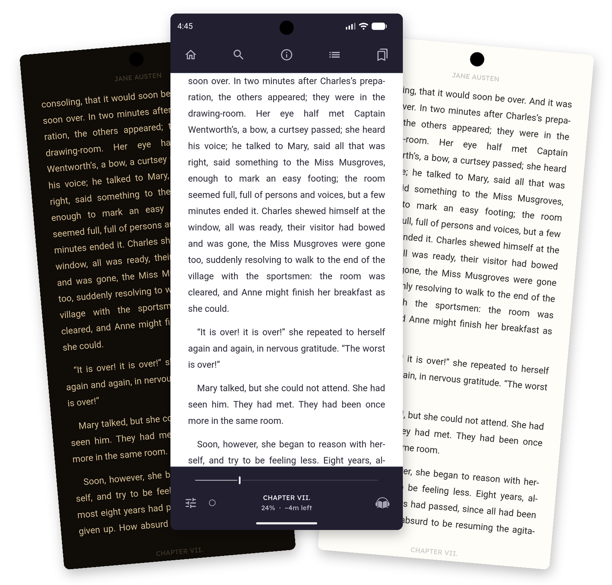
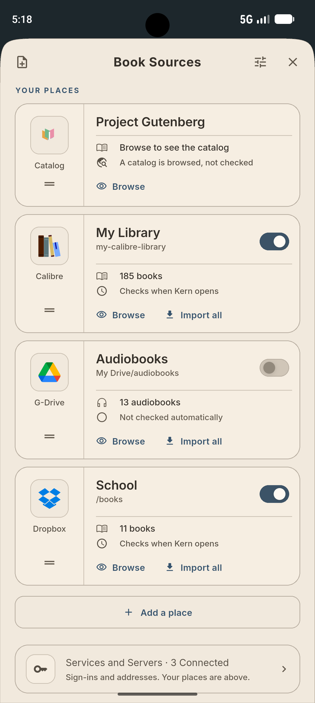
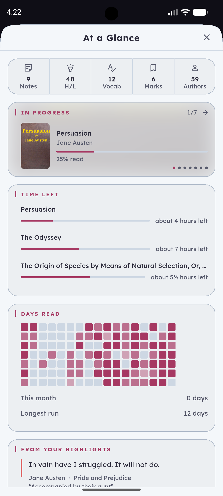

# Kern

**A private, full-featured reader for Android.**

EPUB, PDF, CBZ comics and M4B, M4A or MP3 audiobooks in one library, with
serious typography, flexible organisation, deep metadata handling, and direct
access to books you already keep in cloud storage.

**Play Store:** Coming Soon

**Contact:** kernreader@gmail.com

Kern is being built as the kind of reader I wanted to use myself: polished
enough to use every day, private by design, and sold like ordinary software. No
Kern account. No telemetry. No subscription.

<!--
SCREENSHOT BRIEF — HERO
Use one strong, wide tablet screenshot here.
Best subject: Bookshelf / Home with several shelves visible, mixed formats, some side-panel content, and a theme that reads well at GitHub width.
This should communicate "mature reading app" before the reader has read a feature list.
Suggested path: docs/screenshots/kern_library_tablet.png
-->

## The short version

### Your reading stays yours

Kern is a local application. Your library, reading positions, highlights, notes
and settings are stored on your device.

There is no Kern account and no Kern server. Kern contains no analytics,
telemetry, advertising or crash-reporting SDK.

### Buy it once. Keep it.

Kern is being built as a one-time purchase, not a subscription. The reader and
your library should not become something you have to keep renting.

### A reader first

Privacy and ownership matter, but neither means much if the reader itself is
thin.

Kern supports EPUB, PDF, CBZ comics and M4B, M4A or MP3 audiobooks natively,
with reading tools, library organisation, metadata, annotations, text to speech,
backup, sync, cloud sources and extensive visual customization built around
them.

---

## Reading

EPUB is the primary format, but PDF, CBZ comics and audiobooks are fully
supported rather than treated as side features or converted into something else.

Each format gets behaviour suited to it: typography and reading controls for
reflowable books, native PDF handling, guided comic reading, and a complete
audiobook player with background playback and position tracking.

<!--
SCREENSHOT BRIEF — READING TRIPTYCH
Use three phone screenshots with the same crop and approximate height:
1. Final reader view with the shipped paper/ink colours.
2. Text selection / dictionary / highlight panel.
3. Audiobook player.
This is the most important "not quick and dirty" proof in the README: three distinct reading modes, each looking finished.
-->
<table>
  <tr>
    <td width="33%" align="center">
      
    </td>
    <td width="33%" align="center">
      
    </td>
    <td width="33%" align="center">
      
    </td>
  </tr>
</table>

### Reading tools

- Highlights, notes and bookmarks
- Offline dictionary packs
- Saved vocabulary
- Text to speech using system voices or Studio voices
- Word tracking during read-aloud
- Search and text actions from selection
- Book, author and character information without leaving the reader
- Reader-specific typography, themes, brightness and layout controls

The character index is built from the book itself, so you can check who someone
is without being shown anything from later in the story.

---

## A library that can actually grow

Kern is designed for mixed personal libraries that have accumulated over time:
different formats, inconsistent metadata, multiple storage locations, unfinished
series, books you meant to return to, and collections that no longer fit neatly
into one shelf.

Smartlists are saved queries over the library. They can use author, genre,
length, reading state, source and combinations of those conditions, and they
stay current as the library changes.

Collections are for deliberate curation. Smartlists are for rules. Both can be
shared.

<!--
SCREENSHOT BRIEF — LIBRARY DEPTH
Use two tablet screenshots side by side:
1. Collections or Explore/Collections, ideally with rich metadata visible.
2. Smartlist editor showing the actual rule builder and live match preview.
These prove that "organisation" means real systems, not a tag field and a filter icon.
-->
<table>
  <tr>
    <td width="50%" align="center">
      
    </td>
    <td width="50%" align="center">
      
    </td>
  </tr>
</table>

### Metadata

Kern reads embedded metadata, repairs common defects, and resolves author
identity across the inconsistent spellings and name orders real libraries
accumulate.

Manual corrections are kept and are not overwritten by automated enrichment.

Book and author information is available inside the reader, alongside the
library rather than in a separate web experience.

<!--
OPTIONAL SCREENSHOT BRIEF — METADATA / AUTHOR
If the README still feels visually sparse here, use one phone shot of the book info panel on the Author tab.
Do not add this if the page already feels image-heavy.
Suggested path: docs/screenshots/kern-author-panel.png
-->
<!--  -->

---

## Make it yours

Kern includes nine built-in themes, with independent light and dark variants,
and a Theme Studio for creating your own.

Themes can be exported and shared. Reader appearance is separate from the app
shell, so the page can be tuned for comfortable reading without forcing the
entire application into the same palette.

<!--
SCREENSHOT NOTE — THEMES
Reader composite uses Amber dark, Amber light and Vesper light with controls.
The library-theme alternative is saved as kern-theme-range.png.
-->

---

## Book sources

Kern can read from local folders and connect to storage services where books
already live, instead of requiring everything to be copied into one private app
silo.

Currently supported:

- Google Drive
- Dropbox
- OneDrive
- WebDAV
- SFTP
- SMB
- Calibre Content Server
- OPDS catalogs

pCloud support is planned. Proton Drive support is also being investigated.

Kern reads only from folders you select. It does not browse or index unrelated
storage, and it does not delete or modify your existing files.

Credentials are held in the platform's encrypted secure storage on the device.
Access can be revoked inside Kern or from the provider itself.

<!--
SCREENSHOT BRIEF — BOOK SOURCES
Use one screenshot from the normalized Book Sources work.
Prefer a screen that shows several source types or one source's setup/status clearly.
This is worth including because it demonstrates that cloud/local sources are a first-class part of the app rather than a single "Import from Drive" button.
-->

  

---

## Backup and multi-device reading

Kern can create a full library backup and guide you through restoring it,
including reconnecting storage sources.

Reading position, annotations and library state can also be synchronized between
your own devices through storage you control.

Kern does not operate a sync server. Backups and sync records are written to
storage you chose.

---

## Privacy

Kern does not collect your reading activity.

It contains no analytics, telemetry, advertising or crash-reporting SDK. There
is no Kern account and no server operated by the developer that receives or
stores your library data.

Network access happens only when a feature needs it: for example, a cloud source
you connected, metadata lookup, an optional voice or dictionary download, or an
integration you explicitly enabled.

See **[PRIVACY.md](PRIVACY.md)** for the full policy, including a
permission-by-permission explanation of what Kern requests and why.

---

## Integrations

Highlights and notes can be exported to:

- Readwise
- Notion
- Obsidian
- Anki
- Hardcover
- BookWyrm

Each integration is opt-in and authorised separately.

Kern can also package and share themes, smartlists and collections.

---

## Feature overview

Kern currently includes:

- Native EPUB, PDF, CBZ and audiobook (M4B, M4A, MP3) support
- Smartlists and collections
- Metadata repair and enrichment
- Author identity resolution
- Highlights, notes, bookmarks and vocabulary
- Offline dictionary
- Text to speech with system and Studio voices
- Character index
- Guided comic reading
- Audiobook playback with background support
- Reading history and library activity views
- Nine built-in themes
- Theme Studio
- Independent light and dark theme variants
- Backup and guided restore
- Multi-device sync through your own storage
- Local, cloud and Calibre book sources
- Export integrations
- Shareable themes, smartlists and collections

<!--
OPTIONAL SCREENSHOT BRIEF — "DEPTH" IMAGE
If you want one final image before Development status, use either:
- At a Glance / reading history, or
- Sharing Center.
Pick only one. It should feel like a pleasant "there is more here" coda, not another feature dump.
-->
<!--  -->

---

## Development status

Kern is in active pre-release development and is preparing for a Google Play
release.

Development began in May 2026. The application is in daily use against real
libraries during development, with testing on Android emulators and physical
devices.

The remaining work is primarily device testing, release hardening and Google
Play requirements.

iOS is not currently available. Groundwork exists in the codebase, but no iOS
build has been shipped and it is not being claimed as a supported platform.

### Project scope

As of October 29, 2026.

<!-- Counts from the private app working tree: Dart under lib/ (including generated code); *_test.dart under test/; top-level Markdown files under docs/. Line counts include blank lines and comments. History counts cover commits reachable from HEAD and distinct commit dates. Storage backends count active registry providers, including OPDS and excluding dormant pCloud and local device folders. -->

| | |
|---|---|
| **Application code** | 325,155 lines of Dart across 548 files |
| **Test suite** | 387 test files, 92,092 lines |
| **Development history** | 904 commits across 112 active days since version control was adopted on 2026-06-16 |
| **Design documentation** | 110 top-level Markdown documents |
| **Formats supported** | EPUB, PDF, CBZ; M4B, M4A and MP3 audiobooks |
| **Storage backends** | 8 |
| **Third-party integrations** | 6 |
| **Built-in themes** | 9     |
| **Minimum platform** | Android 7.0 (API 24) |

Kern also maintains a fork of the Readium toolkit, extended for the rendering,
navigation and text-to-speech behaviour the application needs.

---

## Support

Issues and feature requests: [GitHub issues](../../issues).

Useful details when reporting a problem are the book format, the device, and
where the file came from.

When requesting features, please include as detailed a use case as possible.

---

## Repository contents

This repository hosts release notes, issues and documentation for Kern.

The application source is maintained in a separate private repository.
